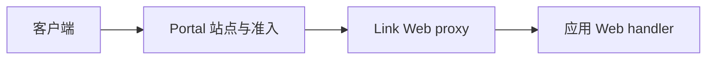

# Web 应用

Web 能力用于为应用注册 HTTP 路由、静态资源或开发服务器代理。`.skel` 负责声明 Web 名称和允许访问的 Actor，Go handler 负责具体路由。

## 声明入口

```skel title="web.skel"
web UserPortalWeb {
    for ClientActor
    auth required
}
```

声明的 auth 模式决定 Portal 如何准入请求，见[认证模式](../runtime/portal.md#认证模式)。

当前端需要固定的公开前缀时，加上 `mount /path`。此时 Portal 会使用该前缀进行匹配和
转发，而不是站点规则上配置的前缀；handler 中的路由仍相对该前缀书写，因此声明
`mount /console` 时，`router.GET("/health", ...)` 对外提供的是 `/console/health`。
路由行为见 [Portal](../runtime/portal.md#入口路径映射)，声明写法见
[Skel 语法参考](https://skel.yorun.ai/docs/actors-and-access)。

生成代码后，实现对应的 Web server，并在 `Routes` 中注册路由：

```go title="web.go"
type UserPortal struct {
    skeled.DefaultUserPortalWebServer
    Context *gin.Context `inject:""`
}

func (h *UserPortal) Routes(router *web.Router) {
    router.GET("/health", h.Health)
}

func (h *UserPortal) Health() {
    h.Context.JSON(200, map[string]string{"status": "ok"})
}
```

用 `router.SubRouter("/orders")` 把相关路由归组到同一路径下。`BasePath()` 返回 Router
在 Web 内的累计路径：根 Router 返回该 Web 的挂载路径，未声明挂载路径时返回 `"/"`；
orders Router 返回 `"/orders"`，其 `SubRouter("/:id")` 返回 `"/orders/:id"`。转发前被
剥离的入口前缀不包含在内，因此仅凭此值不能还原外部 URL。

在应用中启用 Web 能力并注册 handler：

```go title="app.go"
type DemoApp struct {
    app.Application
    app.WebberEnabled
}

func (*DemoApp) WebberInitHandlers(add app.TypeAdder) {
    add(app.T[*UserPortal]())
}
```

Vine 将 Web 能力注册到 Link；Portal 根据站点规则发现 endpoint 并转发外部请求。

## 请求路径



handler 读取的路径从自身挂载位置开始：声明 `mount /console` 的 Web，收到 `/console/orders` 的请求时读到的是 `/console/orders`，注册的路由也基于同一路径解析。

standalone 模式仍走相同的匹配与转发逻辑，但 endpoint 使用进程内连接。

### 静态资源

在 Web handler 中匿名内嵌 `web.AssetsServer`，在 `DIInit` 中设置 accessor，并把 `Routes` 委托给它：

```go title="assets.go"
//go:embed dist
var assetsFS embed.FS

type UserPortal struct {
    skeled.DefaultUserPortalWebServer
    web.AssetsServer
}

func (h *UserPortal) DIInit() {
    h.AssetsServer.SetAccessor(web.NewEmbedAssetsAccessor(assetsFS, "dist"))
}

func (h *UserPortal) Routes(router *web.Router) {
    h.AssetsServer.Routes(router)
}
```

必须匿名按值内嵌：`Serve` 需要属于注册进框架的 handler 类型，写成具名字段或指针内嵌会在注册时 panic。accessor 通过 `DIInit` 注入。

`AssetsServer.Routes` 既处理挂载路径之下的所有路径，也处理挂载根路径本身，因此访问挂载根会返回 index，而不是重定向到应用内部保留的路径；`*path` 参数表示挂载路径之后的部分，未声明挂载路径的 Web 则从根路径提供服务。

### 开发服务器

开发构建可以让 Web 直接由前端自己的开发服务器提供内容，而不使用内嵌资源。在 handler 中按值内嵌 `web.DevProxyServer`，指向开发服务器写入的状态文件，并把 `Routes` 委托给它：

```go title="dev.go"
type UserPortal struct {
    skeled.DefaultUserPortalWebServer
    web.DevProxyServer
}

func (h *UserPortal) DIInit() {
    h.DevProxyServer.SetStateFile("./dev-server.json")
}

func (h *UserPortal) Routes(router *web.Router) {
    h.DevProxyServer.Routes(router)
}
```

状态文件以 JSON 记录开发服务器监听的 `host` 与 `port`；`host` 为空表示应用所在的机器。文件路径可自行选择，启动前端的进程必须写入同一个文件。文件最多每秒重新读取一次，因此前端更换端口重启后，无需重启应用即可跟随。状态文件读取失败时继续使用已经跟随的开发服务器；开发服务器未响应的请求返回 `502`，因为 Web 自身没有内容可提供。Web 收到的路径会保持客户端发送时的转义形式转发给开发服务器。

### 自定义反向代理

对于其他后端，可以在已注册的 Web handler 中调用 `web.ServeReverseProxy`，传入配置好的 `net/http/httputil.ReverseProxy`、注入的 `*gin.Context`，以及来自 `go.yorun.ai/vine/core/logger` 的 `*logger.Logger`：

```go
func (h *UserPortal) Serve() {
    web.ServeReverseProxy(h.Proxy, h.GinCtx, h.Logger)
}
```

该函数通过代理的 `Rewrite` 或 `Director` 转发当前请求，并支持 WebSocket 升级。响应仍会经过
你的 `ModifyResponse`，非取消失败会调用你的 `ErrorHandler`。代理失败日志由该函数写出，因此
配置的 `ErrorLog` 不会被使用。确认由客户端取消导致的失败会直接中止请求，不调用错误处理
钩子，也不生成 502 响应。成功透传的上游 5xx 响应记为 Debug 而不是 Error（见
[框架请求日志](./logging-testing.md#框架请求日志)）；直接调用 `ReverseProxy.ServeHTTP`
仍按状态码分级。独立 Gin router 调用该函数不会获得 Vine 的请求完成日志。

Portal 配置见 [Portal](../runtime/portal.md)，Actor 与 Web 语法见 [Skel 语法](https://skel.yorun.ai/docs/syntax)。
